# Customer Review Sentiment Analysis

[](https://github.com/golshidr/customer-review-sentiment-analysis/actions/workflows/ci.yml)


Binary sentiment classification of written reviews, from a TF-IDF + logistic regression baseline to
fine-tuned transformers, with a leakage-free evaluation protocol, statistical tests, cross-domain
transfer to customer reviews, explanation faithfulness, behavioural tests and calibration.

The project started as a single exploratory notebook
([`notebooks/customer_review_sentiment_analysis.ipynb`](notebooks/customer_review_sentiment_analysis.ipynb))
that trained TF-IDF + logistic regression on the IMDb Large Movie Review Dataset. It is now an
installable Python package (`src/review_sentiment`) with a command-line interface, tests and CI.
Every number and figure below is produced by the code in this repository.

## Key results

| | Result |
|---|---|
| Evaluation fix | The notebook's random 80/20 re-split put a review of the same movie in training for 96% of test reviews. On movie-disjoint, de-duplicated splits the same model scores 88.3%, not 89.6%. |
| Best model | Fine-tuned **DeBERTa-v3-large: 96.73%** accuracy [96.52, 96.95] on 24,877 official IMDb test reviews, against **90.28%** for the tuned TF-IDF baseline and 88.11% for the original model. That is a third as many errors (813 vs 2,419; McNemar p = 2.6e-268). |
| Cheap baseline fix | Tuning TF-IDF + LR on the validation split adds 2.2 points. The biggest single change is keeping stop words, because scikit-learn's stop-word list deletes "not", "no", "never", "but" and "however". |
| Customer reviews | Trained on movie reviews only, DeBERTa-v3-large scores 95.8% on Amazon and 97.2% on Yelp reviews. The TF-IDF models lose 5-8 points outside movies; the transformers lose at most 1.9. |
| Explanations | Exact TF-IDF word contributions are faithful (AOPC 0.60 vs 0.04 for random words). Integrated Gradients on DeBERTa beats random (0.16 vs 0.04), but gradient x input barely does (0.05). |
| Behavioural tests | The TF-IDF models fail 89-100% of negation templates. The transformers handle "not great" but call "not terrible" negative in 12-66% of cases. |
| Calibration | Transformers are overconfident (temperature 1.66-1.89), TF-IDF underconfident (0.63-0.69). A temperature fitted on IMDb does not always transfer: on Yelp it doubles DeBERTa-v3-large's ECE. |
| Hardest cases | 4- and 7-star reviews (89-93% for DeBERTa-v3-large, vs 98% for clear-cut ratings). The most confident errors are mostly sarcasm or reviews whose text contradicts their rating. |

<p align="center"></p>

## Contents

- [What is in this repository](#what-is-in-this-repository)
- [Pipeline](#pipeline)
- [Results](#results)
  - [1. Evaluation fix: the original split leaked test information](#1-evaluation-fix-the-original-split-leaked-test-information)
  - [2. Fine-tuned transformers vs the TF-IDF baseline](#2-fine-tuned-transformers-vs-the-tf-idf-baseline)
  - [3. Cross-domain transfer to customer reviews](#3-cross-domain-transfer-to-customer-reviews)
  - [4. Explanations and how faithful they are](#4-explanations-and-how-faithful-they-are)
  - [5. Behavioural (CheckList-style) tests](#5-behavioural-checklist-style-tests)
  - [6. Calibration](#6-calibration)
  - [7. Error analysis](#7-error-analysis)
- [Quickstart](#quickstart)
- [Reproducing the results](#reproducing-the-results)
- [Project structure](#project-structure)
- [Data](#data)
- [Limitations](#limitations)
- [Next steps](#next-steps)
- [References](#references)

## What is in this repository

| Component | Description |
|---|---|
| Leakage-free protocol | Official movie-disjoint IMDb split, exact duplicates removed, movie-grouped validation set |
| Classical baseline | The notebook's TF-IDF + logistic regression, unchanged, plus a version tuned on the validation set |
| Transformers | DistilBERT, RoBERTa-base (with a head+tail truncation ablation), DeBERTa-v3-base and -large, fine-tuned on one A100 |
| Statistics | Bootstrap 95% CIs, paired bootstrap differences and exact McNemar tests on the same test reviews; three training seeds for the main transformers |
| Cross-domain test | IMDb-trained models scored on Amazon and Yelp customer reviews |
| Explainability | Exact word contributions (LR), Integrated Gradients and gradient x input (transformers), and a deletion test of explanation faithfulness |
| Behavioural tests | Negation, contrast, typos, irrelevant sentences, intensifiers and appended praise or complaints |
| Calibration | Reliability diagrams, ECE, temperature scaling fitted on validation data |
| Error analysis | Accuracy by length, negation, contrast words and star rating; most confident errors |
| Demo | Gradio app that classifies a review and highlights influential words |
| Engineering | `pip install -e .`, YAML configs, CLI, 45 unit tests, ruff, GitHub Actions, Makefile, [model card](MODEL_CARD.md) |

## Pipeline

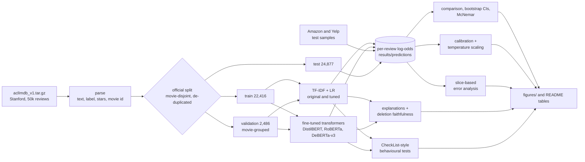

Every model writes one log-odds score per review to `results/predictions/*.csv.gz`. All tables and
figures are computed from these files and the other small files in `results/`, so
`make compare calibration figures tables` re-creates them on a laptop without a GPU. The slice
analysis (`make errors`) also needs the IMDb data (`make data`).

## Results

All models are evaluated on the same 24,877 official IMDb test reviews. Transformers were fine-tuned
for two epochs (learning rate 1e-5 to 3e-5, batch size 16, maximum 512 tokens, bf16) and the
checkpoint with the best validation accuracy was kept. The classical models were trained on the same
22,416 training reviews.

### 1. Evaluation fix: the original split leaked test information

The notebook concatenated the official IMDb train and test sets and re-split them at random 80/20.
The dataset authors made the official train and test sets contain *disjoint movies* (aclImdb README),
because reviews of the same movie share names, plot words and correlated ratings. After a random
re-split, about 96% of test reviews have a review of the same movie in the training data, and
126-149 test reviews (depending on the seed) are exact duplicates of training reviews.

Re-running the notebook's exact model under three protocols (`python -m review_sentiment leakage`):

| Protocol | Runs | Test accuracy | Test reviews whose movie is in train | Exact duplicates |
|---|---|---|---|---|
| Original: random re-split of the pooled 50k reviews | 5 seeds | 0.8964 +/- 0.0025 | 96.3% | 136 (mean) |
| Same pool and sizes, split by movie, de-duplicated | 5 seeds | 0.8831 +/- 0.0048 | 0% | 0 |
| Official split, de-duplicated (used from here on) | 1 | 0.8830 | 0.09% (one movie id) | 0 |

The random split overstates accuracy by about 1.3 points. The gap is not caused by training-set size:
the movie-grouped split trains on about 40k reviews, like the original. All results below use the
official split, with 98 duplicate training reviews and 123 test reviews that duplicate a training
review removed, and a 10% movie-grouped validation set carved from the training data.

<p align="center">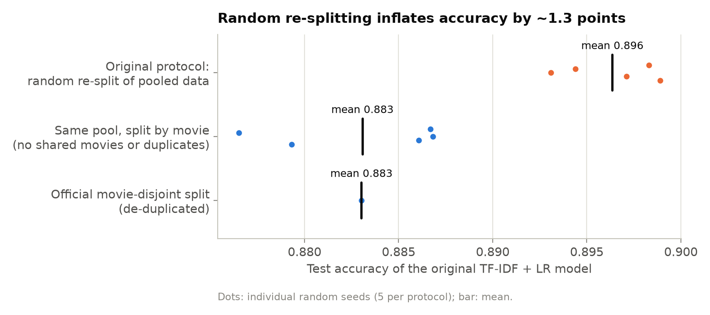</p>

### 2. Fine-tuned transformers vs the TF-IDF baseline

| Model | Accuracy % [95% CI] | Accuracy % over seeds (mean +/- sd) | Macro-F1 | ROC-AUC | ECE | Params | Train time | Inference |
|---|---|---|---|---|---|---|---|---|
| TF-IDF + LR (original) | 88.11 [87.71, 88.52] | - | 0.8811 | 0.9509 | 0.085 | - | 9 s | 4,163/s (CPU) |
| TF-IDF + LR (tuned) | 90.28 [89.93, 90.63] | - | 0.9028 | 0.9653 | 0.057 | - | 12 s | 3,810/s (CPU) |
| DistilBERT | 93.15 [92.84, 93.46] | 93.19 +/- 0.04 (n=3) | 0.9315 | 0.9802 | 0.048 | 67M | 73 s | 1,014/s (A100 GPU) |
| RoBERTa-base | 95.49 [95.22, 95.76] | 95.34 +/- 0.14 (n=3) | 0.9549 | 0.9894 | 0.036 | 125M | 134 s | 896/s (A100 GPU) |
| RoBERTa-base (head+tail) | 95.51 [95.24, 95.77] | - | 0.9551 | 0.9904 | 0.036 | 125M | 137 s | 811/s (A100 GPU) |
| DeBERTa-v3-base | 96.20 [95.96, 96.44] | 96.21 +/- 0.02 (n=3) | 0.9620 | 0.9921 | 0.028 | 184M | 354 s | 392/s (A100 GPU) |
| DeBERTa-v3-large | 96.73 [96.52, 96.95] | - | 0.9673 | 0.9940 | 0.026 | 435M | 1669 s | 190/s (A100 GPU) |

Train time is the fit of the TF-IDF pipeline, or the fine-tuning loop for transformers
(tokenisation excluded). Inference is end-to-end throughput, tokenisation included, on the same
5,000 test reviews, measured one model at a time with nothing else on the GPU
(`python -m review_sentiment benchmark`).
DeBERTa-v3-large shared its GPU with the explanation job for most of its training run, so its
training time is an upper bound. DistilBERT, RoBERTa-base and DeBERTa-v3-base were trained with
three seeds (42, 43, 44; the data split is fixed); the confidence interval is for the seed-42 run.
Seed-to-seed variation (standard deviation 0.02-0.14 points) is small compared with the
differences between model families.

Paired comparisons on the same test reviews (bootstrap CI of the accuracy difference, exact McNemar
test on the reviews where exactly one of the two models is right):

| Model vs TF-IDF + LR (tuned) | Accuracy difference, points [95% CI] | Only this model right / only reference right | McNemar p |
|---|---|---|---|
| TF-IDF + LR (original) | -2.17 [-2.50, -1.85] | 601 / 1,141 | 9.4e-39 |
| DistilBERT | +2.87 [+2.51, +3.27] | 1,515 / 800 | 1.3e-50 |
| RoBERTa-base | +5.21 [+4.84, +5.58] | 1,789 / 493 | 9.6e-172 |
| RoBERTa-base (head+tail) | +5.23 [+4.86, +5.60] | 1,778 / 477 | 1.7e-175 |
| DeBERTa-v3-base | +5.93 [+5.55, +6.31] | 1,890 / 416 | 1.8e-223 |
| DeBERTa-v3-large | +6.46 [+6.09, +6.83] | 1,961 / 355 | 2.6e-268 |

| Model vs DeBERTa-v3-base | Accuracy difference, points [95% CI] | Only this model right / only reference right | McNemar p |
|---|---|---|---|
| TF-IDF + LR (original) | -8.10 [-8.50, -7.68] | 423 / 2,437 | < 1e-300 |
| TF-IDF + LR (tuned) | -5.93 [-6.31, -5.55] | 416 / 1,890 | 1.8e-223 |
| DistilBERT | -3.05 [-3.33, -2.77] | 300 / 1,059 | 2e-99 |
| RoBERTa-base | -0.72 [-0.92, -0.50] | 264 / 442 | 2.1e-11 |
| RoBERTa-base (head+tail) | -0.70 [-0.90, -0.49] | 306 / 479 | 7.1e-10 |
| DeBERTa-v3-large | +0.53 [+0.35, +0.72] | 351 / 219 | 3.6e-08 |

Every transformer is significantly more accurate than the tuned TF-IDF model; DeBERTa-v3-base is
significantly more accurate than DistilBERT and RoBERTa-base, and DeBERTa-v3-large beats
DeBERTa-v3-base by 0.53 points [0.35, 0.72]. DeBERTa-v3-large makes 813 errors on the 24,877 test
reviews against 2,419 for the tuned TF-IDF model, about a third as many.

**Truncation ablation.** Reviews longer than 512 tokens are cut. Keeping the first 128 and the last
382 tokens (head+tail, Sun et al., 2019) instead of the first 510 makes no difference overall
(+0.02 points, McNemar p = 0.86). The two inputs only differ for the 3,175 test reviews (12.8%) that
exceed 512 RoBERTa tokens, and there head+tail is more accurate: 94.99% against 93.73%
(104 vs 64 discordant reviews, p = 0.003). On the other 21,702 reviews the inputs are identical and
the two runs differ only through training noise (95.58% vs 95.74%, p = 0.08; RoBERTa-base's
seed-to-seed standard deviation is 0.14 points), which cancels the gain.
(`results/error_analysis/truncation_ablation.csv`; this subgroup comparison was chosen after seeing
the overall result.)

<p align="center">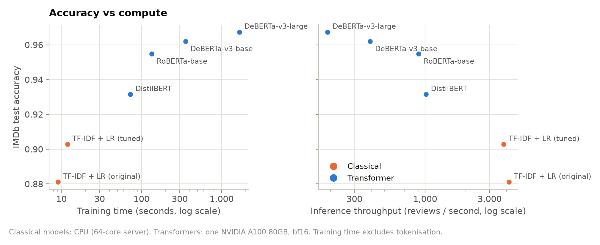</p>

The trade-off: the tuned TF-IDF model scores 3,810 reviews per second on a CPU, 20 times the
throughput of DeBERTa-v3-large on an A100, at 6.5 points lower accuracy. DeBERTa-v3-base gives up
0.5 points of the large model's accuracy for twice its throughput.

The tuned TF-IDF model differs from the original in four settings chosen on the validation set
(36 configurations): no stop-word removal, 50,000 instead of 10,000 features, sublinear term
frequency and C = 4 (it also ignores terms that occur in only one training review). Stop-word
removal matters most: scikit-learn's English stop-word list contains "not", "no", "never",
"nothing", "but", "however" and "very", so the original model cannot see negation, contrast or
intensifiers. The best validation accuracy with stop-word removal was 0.875, against 0.893 without
it.

<p align="center">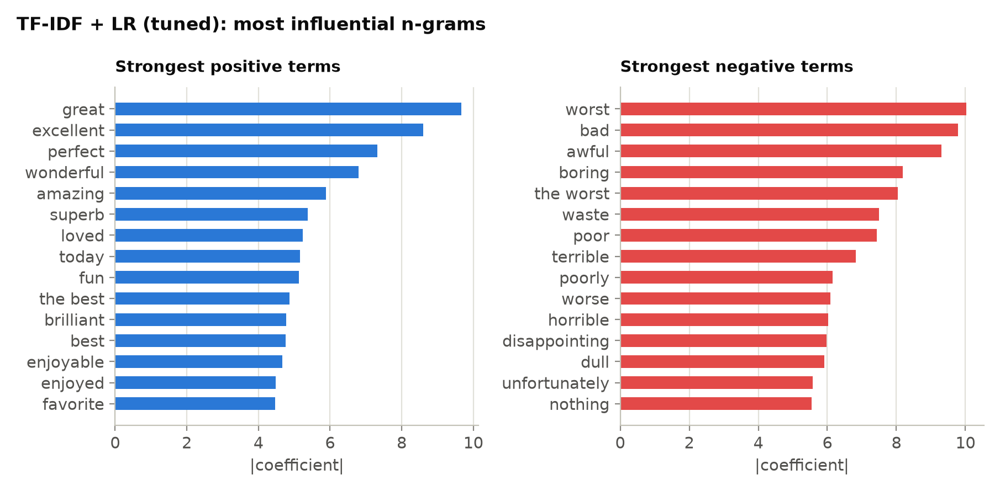</p>

### 3. Cross-domain transfer to customer reviews

The repository is about customer reviews, but IMDb contains movie reviews only. To check how the
models transfer, every IMDb-trained model was scored, without any further training, on label-balanced
samples of 10,000 reviews from the test splits of Amazon Review Polarity (products) and Yelp Review
Polarity (businesses).

| Model (trained on IMDb only) | IMDb test % | Amazon % (change) | Yelp % (change) |
|---|---|---|---|
| TF-IDF + LR (original) | 88.11 | 80.34 (-7.8) | 82.97 (-5.1) |
| TF-IDF + LR (tuned) | 90.28 | 84.53 (-5.7) | 85.49 (-4.8) |
| DistilBERT | 93.15 | 92.18 (-1.0) | 92.46 (-0.7) |
| RoBERTa-base | 95.49 | 93.67 (-1.8) | 95.24 (-0.2) |
| RoBERTa-base (head+tail) | 95.51 | 93.57 (-1.9) | 95.47 (-0.0) |
| DeBERTa-v3-base | 96.20 | 95.65 (-0.6) | 96.29 (+0.1) |
| DeBERTa-v3-large | 96.73 | 95.81 (-0.9) | 97.20 (+0.5) |

The TF-IDF models lose 5-8 points outside movies: their vocabulary is movie vocabulary. The
transformers lose at most 1.9 points, and the DeBERTa models are as accurate on Yelp as on IMDb.
DeBERTa-v3-large reaches 95.8% on Amazon and 97.2% on Yelp without seeing a single product or
restaurant review in training. Both corpora derive labels from star ratings (1-2 stars negative,
4-5 positive, 3 stars excluded), so neutral reviews are absent here too; see
[Limitations](#limitations).

<p align="center">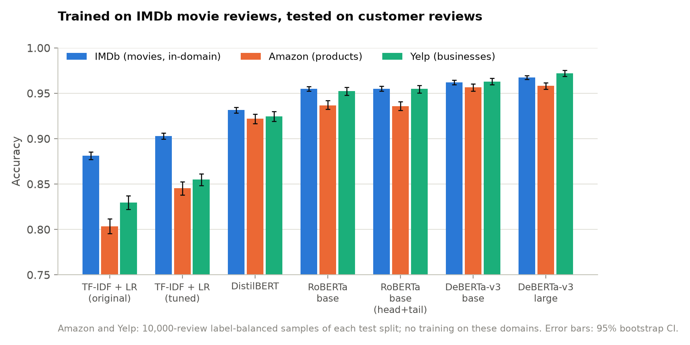</p>

### 4. Explanations and how faithful they are

Explanations are computed per word for both model families: exact contributions for the TF-IDF
model (`tfidf value x coefficient`, which sum to the log-odds minus the intercept) and Integrated
Gradients (Captum; embedding layer; padding-token baseline) or gradient x input for DeBERTa-v3-base.

An explanation is only useful if it reflects what the model actually uses. The deletion test removes
the words an explanation ranks as most supportive of the prediction (5% to 50% of the review) and
measures the drop in the predicted-class probability, compared with deleting the same number of
random words. The summary statistic is the area over the perturbation curve (AOPC; higher is
better). Computed on 500 random test reviews of at most 200 words, with 100 Integrated
Gradients steps (median convergence delta 4.6% of F(x) - F(baseline)).

| Model | Attribution method | AOPC (higher = more faithful) |
|---|---|---|
| TF-IDF + LR (tuned) | LR contribution | 0.600 |
| TF-IDF + LR (tuned) | random | 0.039 |
| DeBERTa-v3-base | Integrated Gradients | 0.160 |
| DeBERTa-v3-base | Gradient x Input | 0.047 |
| DeBERTa-v3-base | random | 0.036 |

- The TF-IDF contributions are faithful by construction: deleting the top 10% of words moves the
  predicted-class probability by 0.47 on average.
- Integrated Gradients identifies words that matter to DeBERTa (AOPC 0.160, 4.4x random), but
  deleting even half of the review lowers the predicted-class probability by only 0.28 on average.
  The transformer spreads its evidence over many words and recovers from deletions; a short list of
  highlighted words explains less of its decision than it does for the linear model.
- Gradient x input is barely better than deleting random words (0.047 vs 0.036) and should not be
  used to explain this model.
- The two models attend to different words: the median Spearman correlation between the LR and IG
  word scores of the same review is 0.08, and their top-5 words overlap by 9.5% on average. In the
  second example below, the TF-IDF model reads "very" and "carries" as positive and "plot" and
  "could" as negative; DeBERTa's strongest negative evidence is "overrated", "moments," (in "It has
  its moments, but ...") and "shallow". IG also gives large scores to function words such as "This"
  and "it.", which a reader would not expect.

<p align="center">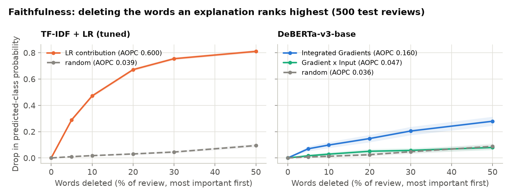</p>

<p align="center">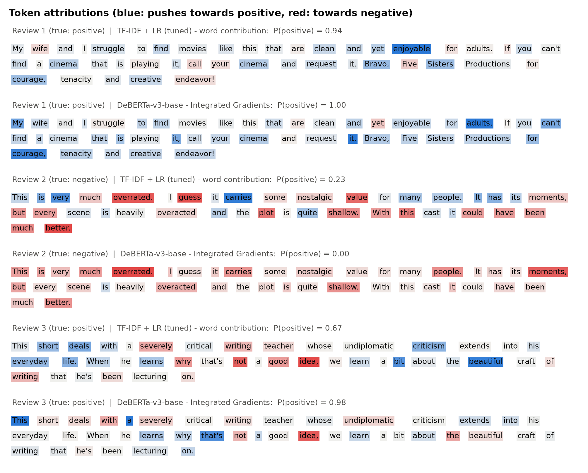</p>

### 5. Behavioural (CheckList-style) tests

Templated sentences and edits of 1,000 random test reviews probe specific abilities. MFT: minimum
functionality (known label). INV: the edit should not flip the prediction. DIR: the edit should not
move P(positive) the wrong way by more than 0.1. Templates use movie and customer-service nouns
(movie, film, product, service, food, staff, hotel, phone).

| Test (failure rate %) | TF-IDF + LR (original) | TF-IDF + LR (tuned) | DistilBERT | RoBERTa-base | RoBERTa-base (head+tail) | DeBERTa-v3-base | DeBERTa-v3-large |
|---|---|---|---|---|---|---|---|
| simple positive (MFT, n=64) | 0.0 | 3.1 | 0.0 | 0.0 | 0.0 | 0.0 | 0.0 |
| simple negative (MFT, n=64) | 0.0 | 0.0 | 0.0 | 0.0 | 0.0 | 0.0 | 0.0 |
| negated positive (MFT, n=128) | 98.4 | 89.1 | 1.6 | 0.0 | 0.0 | 0.0 | 14.8 |
| negated negative (MFT, n=128) | 100.0 | 100.0 | 59.4 | 56.2 | 66.4 | 12.5 | 34.4 |
| contrast neg then pos (MFT, n=64) | 100.0 | 59.4 | 0.0 | 0.0 | 0.0 | 0.0 | 0.0 |
| contrast pos then neg (MFT, n=64) | 6.2 | 0.0 | 0.0 | 0.0 | 0.0 | 0.0 | 0.0 |
| typos 10pct (INV, n=1000) | 2.5 | 2.5 | 3.9 | 2.2 | 1.3 | 1.7 | 0.2 |
| neutral sentence (INV, n=1000) | 1.6 | 2.5 | 2.5 | 0.9 | 0.5 | 0.4 | 0.4 |
| intensifier (DIR, n=128) | 2.3 | 17.2 | 0.0 | 0.0 | 0.0 | 0.0 | 0.0 |
| add negative sentence (DIR, n=501-520) | 0.0 | 0.0 | 0.0 | 0.0 | 0.2 | 0.0 | 0.0 |
| add positive sentence (DIR, n=480-499) | 0.0 | 0.0 | 0.0 | 0.0 | 0.0 | 0.0 | 0.0 |

- **Negation is the main weakness of the TF-IDF models** (89-100% failure on negated templates).
  The original model removes "not", "no", "never", "but", "however" and "very" as stop words, so
  "The movie was not good." and "The movie was good." are the same input to it.
- **Transformers handle negated praise** ("The service was not great." -> negative) but often read
  negated criticism ("The product was not terrible.") as negative: 12% (DeBERTa-v3-base) to 66%
  (RoBERTa head+tail). Some of this is defensible, since "not terrible" is closer to neutral than
  to praise, but a binary classifier has to choose.
- **Bigger is not uniformly better:** DeBERTa-v3-large fails 15% of the negated-praise templates
  ("The film was not excellent." -> P(positive) = 0.83) that DeBERTa-v3-base passes completely, and
  34% of the negated-criticism templates.
- Typos in 10% of the words and an irrelevant appended sentence flip at most 4% of predictions;
  appended praise or complaints moved a prediction the wrong way by more than 0.1 only once in all
  seven models (RoBERTa head+tail).
- The tuned TF-IDF model calls "The movie was impressive." negative (P(positive) = 0.26): "the",
  "movie" and "was" all have negative weights (complaints more often say "the movie was ..."), and
  in a four-word sentence they outweigh "impressive". An intensifier makes it worse ("The movie was
  incredibly good.": 0.28, against 0.51 without "incredibly") because every review vector is
  length-normalised, so each extra word dilutes the weight of "good".

<p align="center">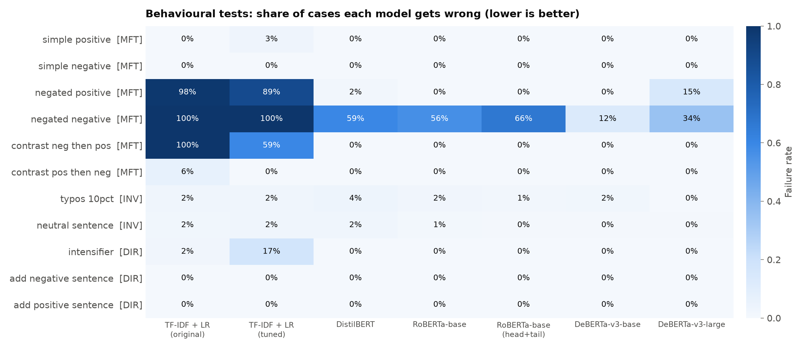</p>

### 6. Calibration

A model is calibrated when its confidence matches its accuracy. Expected calibration error (ECE,
15 bins) before and after temperature scaling; the temperature is fitted on the IMDb validation split
and applied unchanged to the other test sets.

| Model | Temperature (fit on IMDb val) | ECE IMDb test | ECE Amazon | ECE Yelp |
|---|---|---|---|---|
| TF-IDF + LR (original) | 0.63 | 0.085 -> 0.020 | 0.062 -> 0.011 | 0.090 -> 0.023 |
| TF-IDF + LR (tuned) | 0.69 | 0.057 -> 0.012 | 0.054 -> 0.009 | 0.067 -> 0.016 |
| DistilBERT | 1.77 | 0.048 -> 0.032 | 0.051 -> 0.037 | 0.044 -> 0.033 |
| RoBERTa-base | 1.88 | 0.036 -> 0.026 | 0.048 -> 0.030 | 0.034 -> 0.034 |
| RoBERTa-base (head+tail) | 1.89 | 0.036 -> 0.026 | 0.051 -> 0.034 | 0.032 -> 0.032 |
| DeBERTa-v3-base | 1.68 | 0.028 -> 0.021 | 0.030 -> 0.021 | 0.020 -> 0.021 |
| DeBERTa-v3-large | 1.66 | 0.026 -> 0.022 | 0.027 -> 0.025 | 0.014 -> 0.029 |

- The TF-IDF models are underconfident (T < 1: their probabilities should be sharper) and the
  transformers are overconfident (T = 1.66-1.89).
- Temperature scaling reduces ECE on the IMDb test set for every model, and on Amazon reviews as
  well.
- It does not transfer reliably: on Yelp it leaves RoBERTa and DeBERTa-v3-base unchanged and
  doubles the ECE of DeBERTa-v3-large (0.014 -> 0.029). A temperature should be fitted on labelled
  data from the domain where the model is used.
- 92-98% of transformer predictions have confidence above 0.95, so the low-confidence bins of the
  reliability diagrams contain few reviews (bins with fewer than 50 are not drawn).

<p align="center">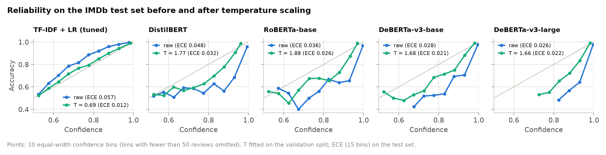</p>

### 7. Error analysis

Accuracy by slice of the 24,877 test reviews (`results/error_analysis/slice_accuracy.csv`):

| Slice | n | TF-IDF + LR (tuned) | DeBERTa-v3-base | DeBERTa-v3-large |
|---|---|---|---|---|
| Strong rating (1-3 or 8-10 stars) | 19,954 | 92.85 | 97.79 | 98.15 |
| Mild rating (4 or 7 stars) | 4,923 | 79.83 | 89.74 | 91.00 |
| Contains "but" or "however" | 19,340 | 89.64 | 95.92 | 96.46 |
| No "but" or "however" | 5,537 | 92.49 | 97.18 | 97.69 |
| Shortest quartile (<= 125 words) | 6,347 | 90.69 | 96.16 | 96.36 |
| Longest quartile (> 274 words) | 6,205 | 89.72 | 95.29 | 96.29 |

- **Mild reviews are the hardest.** 4-star and 7-star reviews account for 20% of the test set and
  about half of DeBERTa-v3-large's errors. These reviews are mixed by nature, and the label is a
  threshold on a rating rather than a property of the text.
- **Contrast words cost accuracy** for every model (2.9 points for TF-IDF, 1.2 for DeBERTa-v3-large).
  Negation words alone are not informative here: 90% of reviews contain one.
- **Long reviews** are slightly harder for every model: from the shortest to the longest quartile
  accuracy drops by about 1 point for TF-IDF and DeBERTa-v3-base and by 0.1 points for
  DeBERTa-v3-large. TF-IDF reads the whole review, so truncation is not the main cause; for its
  effect on reviews over 512 tokens see the truncation ablation above.
- **Complementarity.** DeBERTa-v3-base fixes 1,890 of the tuned TF-IDF model's 2,419 errors and
  introduces 416 new ones; 529 reviews are misclassified by both.
- **The most confident errors are mostly label-text conflicts.** Reading DeBERTa-v3-base's 15
  most confident errors (`results/error_analysis/hardest_errors_deberta.csv`, all with confidence
  above 0.998): 5 are mostly negative texts with 7-9 stars ("one of the worst Columbo episodes ...",
  9 stars), 3 are "so bad it's good" reviews with 10 stars, 4 read as sarcastic praise with 1-2 stars
  ("Master P's acting skills make you actually believe he is Italian!"), 2 contradict their own
  rating ("I give it 9.5/10" on a 1-star review) and 1 is a personal story unrelated to the film.
  At this level the remaining errors say as much about the labels as about the model.

<p align="center">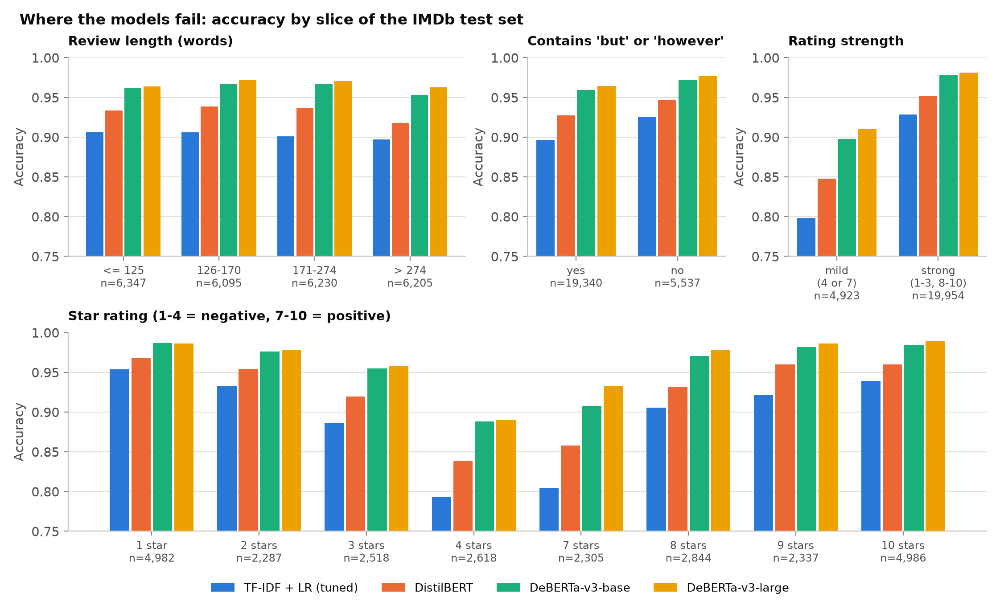</p>

<p align="center">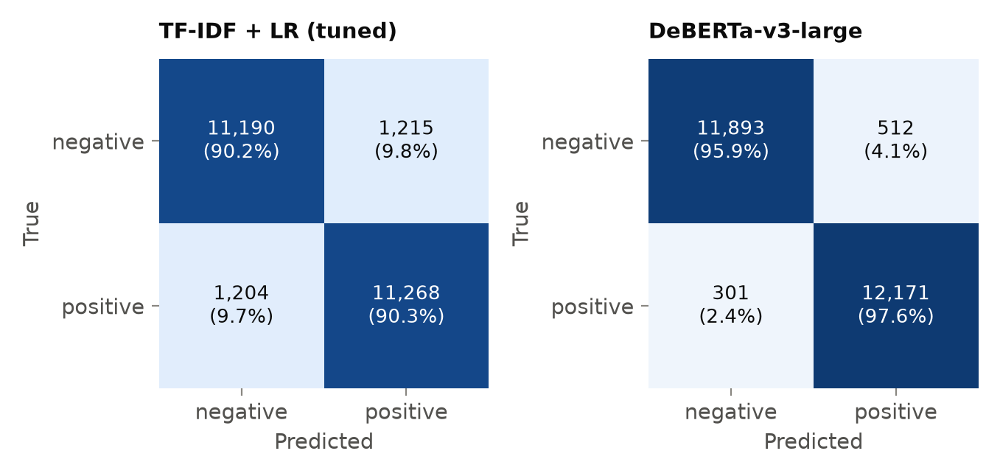</p>

## Quickstart

```bash
git clone https://github.com/golshidr/customer-review-sentiment-analysis.git
cd customer-review-sentiment-analysis
python3.11 -m venv .venv && source .venv/bin/activate
pip install -r requirements.txt --extra-index-url https://download.pytorch.org/whl/cu126
pip install -e . --no-deps

python -m review_sentiment download --cross-domain       # IMDb archive + Amazon/Yelp samples
python -m review_sentiment train-classical --config configs/tfidf_lr_tuned.yaml
python app/app.py                                         # demo at http://127.0.0.1:7860
```

Use the package directly:

```python
from review_sentiment.predictors import load_predictor
from review_sentiment.explain import lr_attributions

model = load_predictor("tfidf_lr_tuned")  # or "distilbert", "roberta", "deberta", "deberta_large"
print(model.margin(["Not bad at all, the staff were lovely."]))  # log-odds of "positive": -1.85
words, scores = lr_attributions(model.pipeline, "Not bad at all, the staff were lovely.")
```

The TF-IDF model reads that sentence as negative ("bad" -1.03, "at" -0.44, "all," -0.46); see the
[behavioural tests](#5-behavioural-checklist-style-tests).

## Reproducing the results

Hardware used: Linux, 64 CPU cores, one NVIDIA A100 80GB (driver 565, CUDA 12.6 wheels),
Python 3.11. The full pipeline (`make all`) takes about two hours, almost all of it transformer
fine-tuning.

```bash
make setup        # .venv with the pinned requirements (edit PYTHON=... to use another interpreter)
make all GPU=0    # everything below, in order
```

or step by step:

| Step | Command | Output |
|---|---|---|
| Data | `python -m review_sentiment download --cross-domain` | `data/processed/*.parquet` |
| Leakage study | `python -m review_sentiment leakage` | `results/leakage/` |
| Classical models | `python -m review_sentiment train-classical --config configs/tfidf_lr_original.yaml` (and `tfidf_lr_tuned.yaml`) | `results/metrics/`, `results/predictions/` |
| Transformers | `python -m review_sentiment train-transformer --config configs/deberta.yaml` (one per config; `--model-seed 43` for extra seeds) | `artifacts/<name>/` (not committed) |
| Cross-domain | `python -m review_sentiment predict-domains --models tfidf_lr_tuned deberta ...` | `results/predictions/*__amazon.csv.gz` |
| Comparison | `python -m review_sentiment compare` | `results/comparison.csv`, `results/significance.csv`, `results/cross_domain.csv` |
| Calibration | `python -m review_sentiment calibration` | `results/calibration/` |
| Error analysis | `python -m review_sentiment errors` | `results/error_analysis/` |
| Explanations | `python -m review_sentiment explain --model deberta` | `results/explain/` |
| Behavioural tests | `python -m review_sentiment robustness` | `results/robustness/` |
| Throughput | `python -m review_sentiment benchmark` | `results/benchmark.csv` |
| Figures and tables | `python -m review_sentiment figures` and `... tables` | `figures/`, `results/tables.md` |

Per-review predictions of every model are committed (`results/predictions/`), so
`make compare calibration figures tables` reproduces the tables and figures on a CPU in a few
minutes without retraining (`make data errors` for the slice analysis). Quality checks:
`make lint test`.

## Project structure

```
customer-review-sentiment-analysis/
├── src/review_sentiment/      # the package
│   ├── data.py                # download/parse IMDb, split protocols, Amazon/Yelp samples
│   ├── preprocessing.py       # clean_text (original), light cleaning, negation detection
│   ├── models/classical.py    # TF-IDF + LR, grid search, coefficients, word contributions
│   ├── models/transformer.py  # fine-tuning loop, head/head+tail truncation, batched inference
│   ├── predictors.py          # one texts -> log-odds interface for every model
│   ├── evaluation.py          # metrics, bootstrap CIs, paired tests
│   ├── calibration.py         # ECE, reliability tables, temperature scaling
│   ├── explain.py             # LR contributions, Integrated Gradients, deletion test
│   ├── robustness.py          # behavioural test suite
│   ├── error_analysis.py      # slices and hardest errors
│   ├── leakage.py             # random vs movie-disjoint split study
│   ├── analysis.py, tables.py # aggregate results into CSV and Markdown tables
│   ├── plotting.py, figures.py# shared style and every README figure
│   └── cli.py                 # python -m review_sentiment <command>
├── configs/                   # one YAML file per model
├── scripts/download_data.py   # same as `python -m review_sentiment download`
├── app/app.py                 # Gradio demo
├── notebooks/                 # the original notebook (reordered so it runs top to bottom)
├── results/                   # metrics, per-review predictions, analysis tables (small files)
├── figures/                   # README figures (figures/original/: the notebook's figures)
├── tests/                     # pytest suite on synthetic data
├── docs/business_insights.md  # notes from the original notebook
├── MODEL_CARD.md
├── Makefile, pyproject.toml, requirements*.txt, .github/workflows/ci.yml
```

## Data

| Dataset | Use | Source | License information |
|---|---|---|---|
| Large Movie Review Dataset v1.0 (Maas et al., 2011) | train / validation / test | `https://ai.stanford.edu/~amaas/data/sentiment/aclImdb_v1.tar.gz` (84 MB; SHA-256 `c40f74a18d3b61f90feba1e17730e0d38e8b97c05fde7008942e91923d1658fe`) | No license file in the archive; the authors ask users to cite the paper. The Hugging Face copy (`stanfordnlp/imdb`) lists the license as "other". |
| Amazon Review Polarity (Zhang et al., 2015) | cross-domain test only | Hugging Face `fancyzhx/amazon_polarity`, test split | Apache 2.0 according to the Hugging Face dataset card |
| Yelp Review Polarity (Zhang et al., 2015) | cross-domain test only | Hugging Face `fancyzhx/yelp_polarity`, test split | Not stated on the Hugging Face dataset card |

The datasets are not redistributed; `python -m review_sentiment download --cross-domain` fetches
everything. `results/` stores review ids, labels and model scores, plus short excerpts (at most 400
characters) of a few dozen test reviews that serve as examples in the error analysis, behavioural
tests and explanation figure. The IMDb archive is read directly because, unlike the Hugging Face
copy, it contains each review's star rating and IMDb movie URL, which are needed for the
movie-disjoint validation split and the rating analysis. Labels: negative = 1-4 stars, positive =
7-10 stars (the dataset excludes neutral reviews).

Pretrained models, downloaded from the Hugging Face Hub (licenses as stated on their model cards):
`distilbert-base-uncased` (Apache 2.0), `roberta-base` (MIT), `microsoft/deberta-v3-base` and
`microsoft/deberta-v3-large` (MIT).

## Limitations

- **Training data is movie reviews only.** The cross-domain results are encouraging for the
  transformers, but two corpora are not all customer feedback; support tickets, app-store reviews
  or survey answers may behave differently.
- **Binary labels, no neutral class.** IMDb excludes 5-6 star reviews and the Amazon and Yelp
  polarity sets exclude 3-star reviews. Real feedback is often mixed, and these models will still
  force it into positive or negative; mild reviews are already where most errors occur.
- **English only.**
- **Limited hyperparameter search for transformers.** Each transformer was trained with one
  configuration based on common fine-tuning defaults; only the TF-IDF model was tuned on the
  validation set. Differences between transformers could change with tuning.
- **Seeds.** DistilBERT, RoBERTa-base and DeBERTa-v3-base were trained with three seeds;
  DeBERTa-v3-large and the head+tail ablation once. Confidence intervals reflect test-set sampling,
  not training randomness.
- **Timing was measured on a shared server** and should be read as relative rather than absolute.
- **Explanation faithfulness** was measured by deleting words, which creates unnatural inputs, on
  500 reviews of at most 200 words. Integrated Gradients depends on the baseline (padding tokens
  here). Explanations were computed for DeBERTa-v3-base, not the large model.
- **The behavioural tests are small** (64-128 templated sentences per capability) and hand-written.
- **Label noise.** Some IMDb ratings contradict their text, which caps achievable accuracy and makes
  differences of a few tenths of a point hard to interpret.
- **Bias and fairness were not evaluated.** Reviews mentioning particular groups, dialects or
  names could be scored differently; this needs a targeted test set.
- **Model weights are not distributed** (`artifacts/` is git-ignored). The configurations reproduce
  them; all seven models train in about an hour on one A100.

## Next steps

- Fine-tune on customer-review data (the Amazon and Yelp training splits) and test on the
  other domain, to measure how much in-domain data adds over IMDb-only training.
- Add a neutral class, for example with 3-class Amazon reviews, so mixed feedback is not forced
  into positive or negative.
- Aspect-based sentiment (price, delivery, staff, quality), which is what customer-feedback
  analysis usually needs.
- Distil DeBERTa-v3-large into a smaller student, or quantise and export to ONNX, to close the
  throughput gap with TF-IDF for CPU deployment.
- Fit the calibration temperature per domain on a small labelled sample.
- Targeted augmentation for negated criticism ("not bad") and sarcasm, then re-run the
  behavioural tests.
- Audit the IMDb labels for the most confident errors (confident learning) and report accuracy
  on a cleaned test subset.
- Deploy the Gradio demo as a Hugging Face Space.

## References

- Maas, A. L., Daly, R. E., Pham, P. T., Huang, D., Ng, A. Y., and Potts, C. (2011). Learning Word Vectors for Sentiment Analysis. ACL-HLT. http://www.aclweb.org/anthology/P11-1015
- Zhang, X., Zhao, J., and LeCun, Y. (2015). Character-level Convolutional Networks for Text Classification. NeurIPS. arXiv:1509.01626
- Sun, C., Qiu, X., Xu, Y., and Huang, X. (2019). How to Fine-Tune BERT for Text Classification? arXiv:1905.05583
- Sundararajan, M., Taly, A., and Yan, Q. (2017). Axiomatic Attribution for Deep Networks. ICML. arXiv:1703.01365
- DeYoung, J., et al. (2020). ERASER: A Benchmark to Evaluate Rationalized NLP Models. ACL. arXiv:1911.03429
- Ribeiro, M. T., Wu, T., Guestrin, C., and Singh, S. (2020). Beyond Accuracy: Behavioral Testing of NLP Models with CheckList. ACL. arXiv:2005.04118
- Guo, C., Pleiss, G., Sun, Y., and Weinberger, K. Q. (2017). On Calibration of Modern Neural Networks. ICML. arXiv:1706.04599

## License

See [LICENSE](LICENSE) (MIT, unchanged from the original repository). The datasets and pretrained
models used here have their own terms; see [Data](#data).
