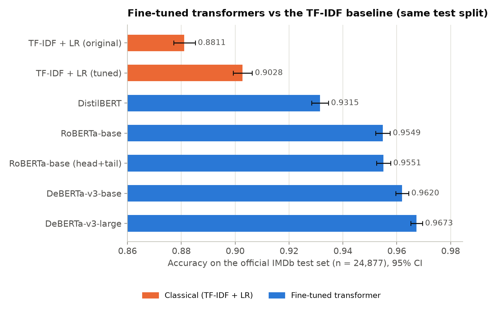

# Customer Review Sentiment Analysis

[](https://github.com/golshidr/customer-review-sentiment-analysis/actions/workflows/ci.yml)
[](.github/workflows/ci.yml)
[](LICENSE)

Binary sentiment classification of English reviews, comparing a TF-IDF + logistic regression
baseline with fine-tuned transformers (DistilBERT, RoBERTa, DeBERTa-v3) under a leakage-free
evaluation protocol on IMDb movie reviews. The models are also tested, without further training, on
Amazon and Yelp customer reviews, and the evaluation covers significance tests, explanation
faithfulness, behavioural tests and calibration. Every number and figure is produced by the code in
this repository.

<p align="center"></p>

## Key results

| Model | IMDb test accuracy % [95% CI] | Amazon % | Yelp % |
|---|---|---|---|
| TF-IDF + LR (original) | 88.11 [87.71, 88.52] | 80.34 | 82.97 |
| TF-IDF + LR (tuned) | 90.28 [89.93, 90.63] | 84.53 | 85.49 |
| DistilBERT | 93.15 [92.84, 93.46] | 92.18 | 92.46 |
| RoBERTa-base | 95.49 [95.22, 95.76] | 93.67 | 95.24 |
| DeBERTa-v3-base | 96.20 [95.96, 96.44] | 95.65 | 96.29 |
| DeBERTa-v3-large | 96.73 [96.52, 96.95] | 95.81 | 97.20 |

All models are trained on IMDb only and evaluated on the same 24,877 official IMDb test reviews and
on 10,000-review samples of Amazon and Yelp reviews.

- **Evaluation fix.** The original notebook's random 80/20 re-split put a review of the same movie
  in training for 96% of test reviews. On movie-disjoint, de-duplicated splits the same model scores
  88.3%, not 89.6%.
- **Fewer errors.** DeBERTa-v3-large makes a third as many errors as the tuned TF-IDF baseline
  (813 vs 2,419; McNemar p = 2.6e-268).
- **Transfer to customer reviews.** The TF-IDF models lose 5-8 points outside movies; the
  transformers lose at most 1.9.

## What's inside

- Fine-tuned transformers (DistilBERT, RoBERTa-base, DeBERTa-v3-base and -large) against a TF-IDF +
  logistic regression baseline, with bootstrap confidence intervals, paired bootstrap differences,
  exact McNemar tests and three training seeds for the main transformers.
- Leakage-free splits: the official movie-disjoint IMDb split, exact duplicates removed and a
  movie-grouped validation set, plus a study of how much the original random split overstated
  accuracy.
- Cross-domain evaluation of IMDb-trained models on Amazon and Yelp customer reviews.
- Token-level explanations (exact word contributions for the linear model, Integrated Gradients and
  gradient x input for transformers) with a deletion test of their faithfulness.
- CheckList-style behavioural tests: negation, contrast, typos, irrelevant sentences, intensifiers
  and appended praise or complaints.
- Calibration: reliability diagrams, expected calibration error and temperature scaling.
- Error analysis by review length, contrast words and star rating, and the most confident errors.
- A Gradio demo that classifies a review and highlights the words that drove the prediction.
- A [model card](MODEL_CARD.md), YAML configs, a command-line interface, 45 unit tests, ruff and
  GitHub Actions CI.

## Quickstart

```bash
git clone https://github.com/golshidr/customer-review-sentiment-analysis.git
cd customer-review-sentiment-analysis
python3.11 -m venv .venv && source .venv/bin/activate
pip install -r requirements.txt --extra-index-url https://download.pytorch.org/whl/cu126
pip install -e . --no-deps
```

On a machine without a GPU, use `--extra-index-url https://download.pytorch.org/whl/cpu`.

Run the demo (downloads the data and trains the TF-IDF model on a CPU first):

```bash
python -m review_sentiment download --cross-domain
python -m review_sentiment train-classical --config configs/tfidf_lr_tuned.yaml
python app/app.py                                   # http://127.0.0.1:7860
```

Reproduce every result, table and figure:

```bash
make all GPU=0
```

## Reproducing the results

| Command | What it does |
|---|---|
| `make setup` | Create `.venv` with the pinned requirements |
| `make all GPU=0` | Full pipeline: data, classical models, leakage study, transformers, analyses, figures and tables |
| `make cpu` | Data, classical models and leakage study (no GPU) |
| `make compare calibration figures tables` | Rebuild the tables and figures from the committed per-review predictions |
| `make lint test` | Quality checks, as in CI |

The transformer targets need a CUDA GPU (`GPU=` selects the device). The results were produced on
one NVIDIA A100 80GB with Python 3.11, and `make all` takes about two hours, almost all of it
transformer fine-tuning. Because the per-review predictions of every model are committed, the
tables and figures can be rebuilt on a CPU in a few minutes. The step-by-step commands are in
[docs/RESULTS.md](docs/RESULTS.md#reproducing-the-results).

## Documentation

- [docs/RESULTS.md](docs/RESULTS.md): full results, including the evaluation fix, significance
  tests, explanations, behavioural tests, calibration, error analysis, limitations and references.
- [MODEL_CARD.md](MODEL_CARD.md): intended use, evaluation data, results and known limitations.
- [CHANGELOG.md](CHANGELOG.md): release notes.
- [notebooks/](notebooks/): the original exploratory notebook, reordered to run top to bottom.

## Project structure

```
customer-review-sentiment-analysis/
├── src/review_sentiment/   # package: data, models, evaluation, calibration, explanations,
│                           #   behavioural tests, error analysis, figures, CLI
├── configs/                # one YAML file per model
├── app/app.py              # Gradio demo
├── scripts/                # data download script
├── notebooks/              # the original notebook
├── results/                # metrics, per-review predictions, analysis tables
├── figures/                # figures used in the README and docs
├── docs/                   # detailed results and notes
├── tests/                  # pytest suite on synthetic data
├── MODEL_CARD.md, CHANGELOG.md, LICENSE
└── Makefile, pyproject.toml, requirements.txt, requirements-dev.txt
```

## Data

- [Large Movie Review Dataset v1.0](https://ai.stanford.edu/~amaas/data/sentiment/) (Maas et al., 2011), for training, validation and testing: no license file in the archive; the authors ask users to cite the paper.
- Amazon Review Polarity (Zhang et al., 2015), Hugging Face `fancyzhx/amazon_polarity`, test split, for cross-domain testing only: Apache 2.0 according to the Hugging Face dataset card.
- Yelp Review Polarity (Zhang et al., 2015), Hugging Face `fancyzhx/yelp_polarity`, test split, for cross-domain testing only: not stated on the Hugging Face dataset card.

The datasets are not redistributed; `python -m review_sentiment download --cross-domain` fetches everything.

## License

Released under the [MIT License](LICENSE); the datasets and pretrained models have their own terms (see [Data](#data) and [docs/RESULTS.md](docs/RESULTS.md#data)).
